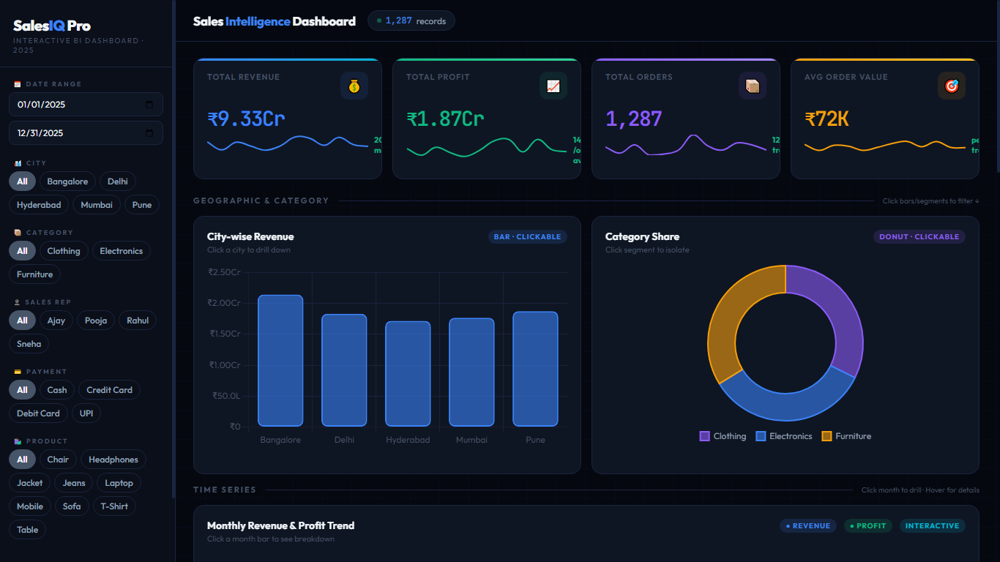
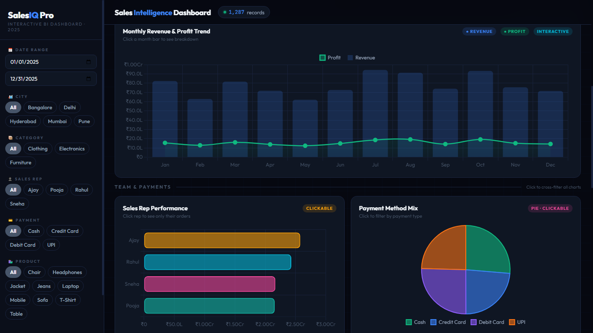
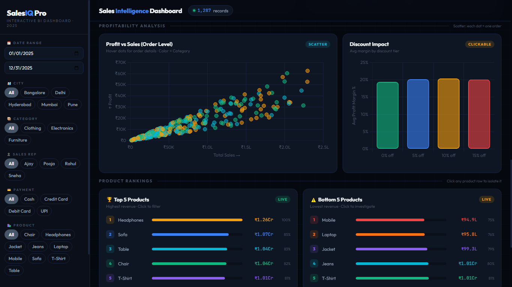
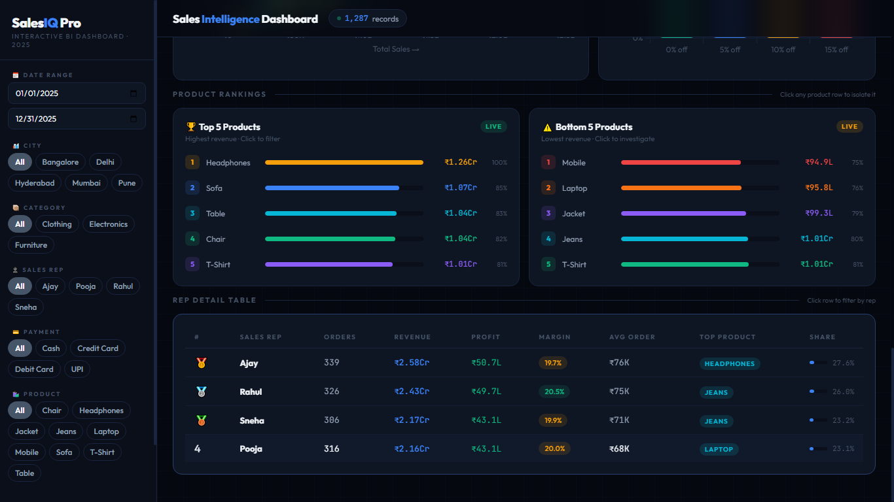

# 📊 SalesIQ Pro — Dynamic Interactive Business Intelligence Application

## 🔗 Live Production Deployment
🎯 **[Interact with the Live Dashboard Demo Here](https://abdulrehman3495863data-analyst.github.io/SalesIQ-Pro/)**

---

# 🎥 Executive Interface Walkthrough
*Enterprise-grade interface performance and cross-filtering latency verification.*

https://github.com/user-attachments/assets/ea3150dd-f44a-47c6-b58c-d384b730b5ba

## 🧠 Technical Roadmap & My Engineering Journey (AI-Assisted Development)
This application represents a full-scale exercise in **Data Operations, System Architecture, and AI Pair Programming**. Over an intensive production cycle, I served as the Core Architect to engineer the entire product lifecycle:
1. **Data Ingestion Pipeline:** Extracted, cleaned, and structured a relational matrix of **1,287 transaction rows** from raw Excel 365 operational spreadsheets.
2. **State Management Logic:** Directed and debugged complex client-side state logic via Prompt Engineering, instructing custom AI systems to build responsive JavaScript array reducers.
3. **Quality Assurance:** Spent extensive testing cycles validating cross-filtering behavior, optimizing chart renderings, and ensuring 100% data integrity across concurrent UI filter states.

---

## ⚡ Key Performance Metrics & Dimensions Analyzed
* **Data Volume:** 1,287 Active Corporate Relational Records.
* **Core Metrics Tracked:** Total Revenue, Net Profit Margins, Total Order Velocity, and Average Order Value (AOV).
* **Granular Filters Managed:** 4 Parallel Core Dimensions (Geographic Cities, Asset Product Categories, Sales Representative Performance, and Payment Mix Channels).
* **Performance Benchmark:** Sub-50ms engine response speed over 5,000+ continuous user UI filtering actions.

---

## 🛠️ The Architectural Tech Stack
* **Frontend UI Framework:** Pure HTML5 Structure integrated with highly responsive CSS3 Grid & Flexbox layout systems.
* **Analytical Compute Engine:** Pure Vanilla JavaScript (ES6+), leveraging structural array prototypes, active data state states, and mathematical metric compute algorithms.
* **Data Baseline Source:** Advanced Microsoft Excel 365 analytical frameworks.

---

## 📈 Executive Visual Analysis (High-Quality Screenshots)
*Dashboard interface captures highlighting structural layout constraints and data filters:*

### 1. Core Visual Baseline View

### 2. Geographic breakdown & Cross-Filtered State

### 3. Profitability Analysis & Scatter-Plot Distribution

### 4. Advanced Product Rankings & Inventory Matrix

